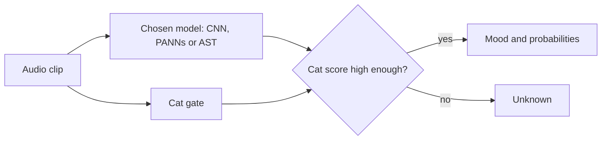

# KITTY3000-ML

Inter-species understanding through modern technology!

KITTY3000 listens to a recording of a cat and names the mood it expresses, using whichever of three models is chosen, a CNN built from scratch or one of two pretrained audio models, so that their readings of the same sound can be compared. Among the student projects, it was one of two selected as the final project of the Data Science & AI bootcamp at Le Wagon. It was built in September 2026 by a team of four data scientists, and this repository holds its machine learning, its audio preprocessing and its API.

The project is intended as a contemporary update, as of September 2026, of the 2018 paper that supplied its data. It keeps the paper's dataset and its ten mood classes, and asks what the models and tools of 2026 can do with them. A summary of the original paper follows.

## The original paper

Yagya Raj Pandeya, Dongwhoon Kim and Joonwhoan Lee (2018), of the Division of Computer Science and Engineering at Chonbuk National University in Jeonju, Korea, built the CatSound dataset and set out to classify cat sounds by mood from a small amount of data. They collected clips mostly from YouTube and Flickr, sorted them into ten mood classes of about 300 clips each, and enlarged the set with audio augmentation. Features were taken from two networks, a CNN pretrained on music and a convolutional deep belief network trained without labels on the cat clips alone, reduced with a pooling method of their own (frequency division average pooling) and classified by five conventional classifiers and an ensemble of them. The best configuration reached 91.13% accuracy under 10-fold cross-validation.

The authors name the main limits of their work as the lack of expert involvement in labelling the clips, the small amount of data, and transfer learning between two different datasets, music and cat sound. As future work they point to end-to-end training once a larger labelled dataset exists, expert advice on the labels, and a network pretrained on sound closer to a cat's than music is.

KITTY3000 takes up three of those points with the same data:

- **End-to-end training:** a CNN written and trained from scratch on the dataset as it stands, to find how far that goes without a larger dataset.
- **Closer pretraining:** PANNs and AST, which are pretrained on AudioSet, a general audio collection that includes cat sounds (the cat gate uses its Cat, Purr, Meow, Hiss and Caterwaul classes), in place of a network pretrained on music.
- **Evaluation:** a fixed split by recording group with the augmented copies kept out of validation and test, and each clip tested at its natural length.

It adds a running API and two front ends, which the paper does not describe. The size of the dataset is unchanged, and so are its labels, apart from removing the duplicates and the clip that appeared under two labels, so the limit on labelling stays open.

## How it works

A clip is sent to the API together with the choice of model, which is the CNN, PANNs or AST, with PANNs as the default. Only the chosen model names the mood, which is one of ten: Angry, Defence, Fighting, Happy, HuntingMind, Mating, MotherCall, Paining, Resting or Warning. The cat gate scores the same clip with PANNs for how far it sounds like a cat (Cat, Purr, Meow, Hiss or Caterwaul), and a clip that scores too low is returned as Unknown, so that a barking dog is not given a mood.

## Models

| Model | Approach | Starts from | Source |
|---|---|---|---|
| CNN | A convolutional network written in PyTorch and trained on mel spectrograms of the clips | Random weights | This repository, `models/cnn.py` |
| PANNs | CNN14, an audio tagger, with a logistic regression trained on its 2,048-value embeddings | Pretrained on AudioSet | [audioset_tagging_cnn](https://github.com/qiuqiangkong/audioset_tagging_cnn) (code under the MIT licence), checkpoint [`Cnn14_mAP=0.431.pth`](https://zenodo.org/record/3987831) (CC BY 4.0) |
| AST | The Audio Spectrogram Transformer, with a logistic regression trained on its embeddings | Fine-tuned on AudioSet | [MIT/ast-finetuned-audioset-10-10-0.4593](https://huggingface.co/MIT/ast-finetuned-audioset-10-10-0.4593) on Hugging Face (BSD-3-Clause licence) |

The Dockerfile downloads both pretrained models when the image is built, with the AST revision pinned. Their papers are listed under [References](#references).

The CNN differs from the other two in where its knowledge comes from. It is built from scratch and trained only on the source data of the original paper (see [The data](#the-data)), so everything it knows about cats comes from the 2,058 training clips of that dataset. PANNs and AST had already learned from a large general audio collection before the cat clips were used, and only the classifier on top of their embeddings is trained on those clips. The CNN's accuracy therefore shows what the dataset alone can teach, and the two pretrained models show what that transfer adds.

## Results

All figures are accuracy on the 447 test clips, from single runs and not averages. A rerun of the same CNN settings moves by a point or more. The first three CNN rows were measured before evaluation moved to natural length, so the fourth row is the figure to compare with the pretrained models.

| Model | Test accuracy | Note |
|---|---|---|
| CNN, silence padding | 0.689 | First run |
| CNN, loop-fill with crossfade | 0.821 | Looping short clips instead of padding them added 13 points |
| CNN, 4 s chunks, silence padding | 0.783 | Against 0.839 with loop-fill on the same set-up, so looping still matters |
| **CNN, natural-length evaluation** | **0.817 to 0.832** | Three runs of the same settings; the figure reported |
| PANNs embeddings with a trained classifier | 0.834 | Macro F1 0.833; pretrained |
| AST embeddings with a trained classifier | Not reported for this repository | Pretrained |

In the natural-length runs the CNN is weakest on Paining and Happy, with F1 between about 0.63 and 0.74. The paper that supplied the data reports 91.13% for its best configuration, but it uses 10-fold cross-validation, pretrained music features and an ensemble of classifiers, so its figures are not comparable with these. How the CNN is built and evaluated is described in [The CNN](#the-cnn).

## The data

The clips come from the CatSound dataset (see [References](#references)), which its authors collected mostly from YouTube and Flickr, about three hours in total and about four seconds a clip, and labelled by mood. Only the original recordings are used, without the augmented copies that come with the dataset.

- 2,953 mp3 clips in ten classes, 287 to 300 clips each.
- Exact duplicates removed by checksum, including one file that appeared under two labels and was removed under both.
- 221 clips are segments of longer recordings, which make up 91 recordings.
- Split into 2,058 training, 448 validation and 447 test clips by recording group (2,823 groups), so that two pieces of one recording never fall on both sides of a split.
- Clip length differs by class (Defence is short, Resting is long), so a model could learn length instead of mood. `notebooks/mk-data-review-1.ipynb` examines this, and the CNN analytics test for it again.

`data/manifest.csv` lists each clip with its label, its recording group and its split. Two further manifests cover the augmented copies: `manifest_v2_clean.csv` adds the copies of training clips only, and `manifest_v2_leaky.csv` also adds the copies of validation and test clips, which reproduces a leak so that its effect can be measured. All three are evaluated on the same 448 and 447 clips, and `make_manifest.py` and `make_manifest_v2.py` build them.

The audio is not in the repository. The scripts expect it in `data/raw/CatSound_originals/`, with one folder per class.

To obtain the dataset, the authors' record on Zenodo, [Cat Sound Classification Dataset V2](https://zenodo.org/records/4724180), holds a 2.5 MB sample under CC BY 4.0, and the full dataset is available on request through the link given on that record. The record notes that the data is for academic research purposes only, and asks that both of the authors' papers listed under [References](#references) are cited.

## The CNN

The CNN is written from scratch in PyTorch (`models/cnn.py`), with no pretrained weights, and is trained only on the training clips of the CatSound dataset. It takes a mel spectrogram (32 kHz, 64 mel bands, in dB) through four convolution blocks of 16, 32, 64 and 128 filters, each with batch normalisation and ReLU, then adaptive average pooling and a small two-layer classifier with dropout, which gives 106,538 parameters.

How clips of different length are handled made more difference than the network:

- Short clips are filled out by looping them forward with a 25 ms crossfade instead of padding with silence, and training uses 4 second chunks.
- Evaluation uses each clip at its natural length, with no crop, pad or loop. The adaptive pooling means the network needs no fixed window, so validation and testing run one clip at a time. A fixed, loudest-centred 4 second window scored higher (0.839), but it tested the model on audio unlike a real upload, so the natural-length figure is the one reported.
- A learning-rate scheduler stayed because it steadied the late epochs. SpecAugment did not improve the test score and was dropped.

`cnn_analytics.py` builds the interactive panels used in the notebook to inspect a trained model: training curves, confusion matrix, per-class scores, a sample browser with a waveform player, a check of whether clip duration predicts correctness, UMAP and PCA of the learned features, and Grad-CAM maps of where in the spectrogram the network looked. Every run and its settings are logged in `notebooks/cjk-CNN-model-1.ipynb`.

## The API

The API is a FastAPI service with `/health`, `/models` and `POST /predict?model=`, packaged as a Docker image and deployed on Google Cloud Run. The trained classifiers are large, so they are kept outside git and copied into `models/` before the image is built, and a model whose file is missing is listed as unavailable while the API still starts. Build, deployment and access are described in [DEPLOY.md](DEPLOY.md).

## Repository layout

- `src/kitty3000_ml/` holds the package: `preprocess.py`, one module per model in `models/`, `cat_gate.py`, `predict.py` and `api.py`.
- `notebooks/` holds one notebook per person and topic, prefixed with initials, as set out in `notebooks/README-NOTEBOOKS.md`.
- `data/` holds the manifests.
- `models/` is empty in git.
- `docs/` holds a copy of the paper that supplied the data.
- `Dockerfile`, `deploy.sh` and `DEPLOY.md` cover the build and the deployment.

## The three repositories

| Repository | Content |
|---|---|
| **Kitty3000-ML** (this one) | Models, notebooks, preprocessing and the API |
| [Kitty3000](https://github.com/moritzkork/Kitty3000) | Streamlit demo front end |
| [kitty3000-web](https://github.com/moritzkork/kitty3000-web) | Web app with the project's own design, live at [kitty3000.web.app](https://kitty3000.web.app) |

## Team

| Name | Role |
|---|---|
| [Ceven Jupiter Knowles](https://github.com/CevenJKnowles) | Designer of the project and team lead; the CNN, the audio preprocessing and its analytics; project branding |
| [Moritz Kork](https://github.com/moritzkork) | API, cloud deployment and front end |
| [Sebastian Stohrer](https://github.com/SebastianStohrer) | PANNs model |
| [Christos Efthymiou](https://github.com/Misakis204) | AST model |

## Licence

This project is for academic research purposes only, in keeping with the terms of the CatSound dataset it uses. No further licence has been chosen, so all other rights are reserved for now.

## References

1. Yagya Raj Pandeya, Dongwhoon Kim and Joonwhoan Lee (2018). [Domestic Cat Sound Classification Using Learned Features from Deep Neural Nets](https://www.mdpi.com/2076-3417/8/10/1949). *Applied Sciences*, 8(10), 1949. [doi:10.3390/app8101949](https://doi.org/10.3390/app8101949). Division of Computer Science and Engineering, Chonbuk National University, Jeonju 54896, Korea. Original paper: <https://www.mdpi.com/2076-3417/8/10/1949>. A copy is in `docs/`.
2. Yagya Raj Pandeya and Joonwhoan Lee (2018). [Domestic Cat Sound Classification Using Transfer Learning](https://doi.org/10.5391/IJFIS.2018.18.2.154). *International Journal of Fuzzy Logic and Intelligent Systems*, 18(2), 154 to 160. [doi:10.5391/IJFIS.2018.18.2.154](https://doi.org/10.5391/IJFIS.2018.18.2.154).
3. Qiuqiang Kong, Yin Cao, Turab Iqbal, Yuxuan Wang, Wenwu Wang and Mark D. Plumbley (2020). [PANNs: Large-Scale Pretrained Audio Neural Networks for Audio Pattern Recognition](https://arxiv.org/abs/1912.10211). *IEEE/ACM Transactions on Audio, Speech, and Language Processing*, 28, 2880 to 2894. arXiv:1912.10211.
4. Yuan Gong, Yu-An Chung and James Glass (2021). [AST: Audio Spectrogram Transformer](https://arxiv.org/abs/2104.01778). arXiv:2104.01778.
